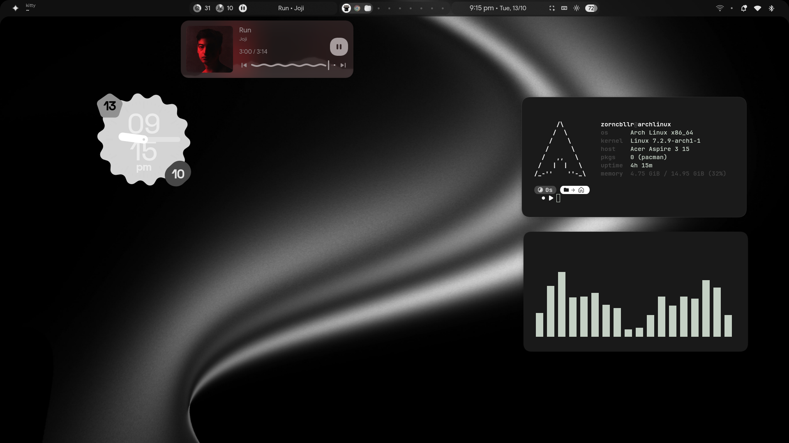
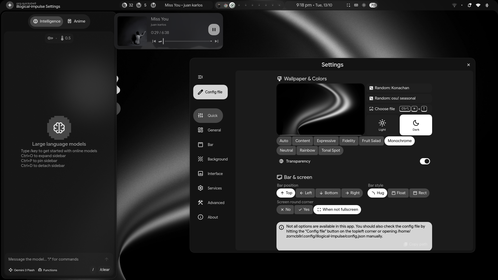
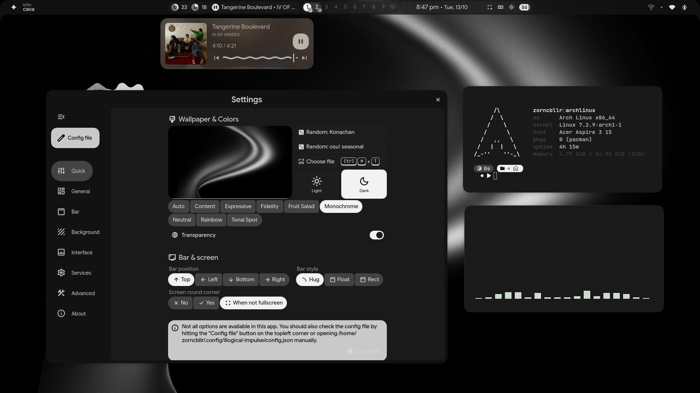
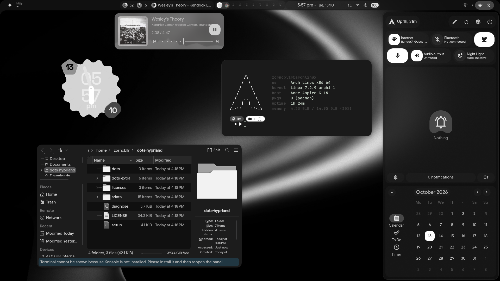
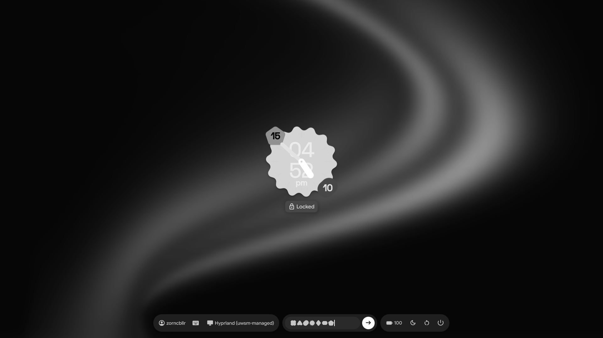

# zorncbllr-dots

An Arch Linux desktop: Hyprland (lua config) + quickshell UI, with a zsh / kitty /
starship / fastfetch terminal. Configs are installed as symlinks (GNU stow), so the
files in `~/.config` *are* the files in this repo and edits are tracked by git.

Repository: <https://github.com/zorncbllr/zorncbllr-dots>



| AI sidebar and settings | Settings, fastfetch and cava widgets |
|---|---|
|  |  |

| Quick settings, calendar and widgets | SDDM login screen |
|---|---|
|  |  |

## Install

Arch Linux only. Run as your normal user (it uses `sudo` where needed).

```sh
git clone https://github.com/zorncbllr/zorncbllr-dots ~/zorncbllr-dots
cd ~/zorncbllr-dots
./install.sh --dry-run      # preview: links per package, existing files, files that differ
./install.sh                # packages + links + groups/services + zsh as login shell
```

Log out and back in afterwards (groups, login shell and environment).

**Keep the clone where you put it.** The symlinks point into this directory; if you
move or delete it, the desktop configs break. If you move it, run `./install.sh` again.

| Option | Effect |
|---|---|
| `--dry-run` | change nothing; show what would be linked or backed up |
| `--no-deps` | skip package installation and the python venv |
| `--no-system` | skip groups, kernel module, services and the login screen (needs sudo) |
| `--no-sddm` | don't install the SDDM theme or enable SDDM |
| `--no-chsh` | keep your current login shell |
| `--verbose` | show all tool output (default: concise steps; details in `~/.local/state/zorncbllr-dots/install.log`) |
| `<pkg> ...` | only link these stow packages, e.g. `./install.sh zsh kitty` |

### What it does
1. **Packages:** installs only what is *missing* (`pacman -T`, so an installed
   provider such as `quickshell-git` is not replaced) via `yay`, from
   `packages/packages.txt`; builds MicroTeX and the cursor theme from `sdata/dist-arch`;
   creates the python venv used by the quickshell scripts.
2. **Links:** existing files that would be overwritten are moved to
   `~/.dotfiles-backup-<timestamp>/`, then each stow package is linked. Links are per
   file (`stow --no-folding`), so files apps create at runtime never land in the repo.
3. **Generated files** (`hypr/hyprland/colors.lua`, `hypr/hyprlock/colors.conf`,
   `fuzzel/fuzzel_theme.ini`, `kdeglobals`) are rewritten whenever the wallpaper or theme
   changes. They are listed in each package's `.seed-files`: copied once as defaults,
   never linked and never overwritten.
4. **Default settings:** on a fresh install `~/.config/illogical-impulse/config.json` is
   seeded once from `stow/quickshell/.config/illogical-impulse/config.json`: only the
   values that differ from the shell's own defaults (Monochrome palette, transparency,
   12-hour clock, `⌘` as the Super label, tray auto-kill, battery and
   pomodoro sounds, clock widget position). An existing config is never touched, and the
   shell is free to rewrite the file afterwards. The wallpaper path is not seeded: first
   run applies `assets/images/default_wallpaper.png`.
5. **System setup:** adds you to `video,i2c,input`, loads `i2c-dev`, enables
   `bluetooth` and the `ydotool` user service, builds the `pkgfile` database.
6. **Login screen:** installs the SDDM theme and enables SDDM (see below).

### Login screen (SDDM)
`sddm/zorncbllr-lock` is an SDDM theme that reproduces the quickshell lock screen: the
blurred, zoomed wallpaper, the centred cookie clock (dial, time numbers, hands, day and
month bubbles) with the "Locked" pill, and the same pill-shaped islands (user / layout /
session, password field, battery / sleep / reboot / power). Typed characters appear as Material shapes
like on the lock screen, and a correct password plays the same unlock animation (blur drops,
wallpaper zooms back, the clock glides to its desktop position, islands fade out). It is a port of the real components, using the bundled
rounded-polygon library. **`./install.sh` does all of it in one go**: it installs SDDM, installs
the theme (with your wallpaper, palette and fonts when they exist, defaults on a fresh machine)
and enables SDDM. If another display manager is already enabled it is left alone and you get
the command to switch; `--no-sddm` skips all of this. To redo just the login screen:

```sh
./sddm/install-theme.sh --preview   # try it in a window, installs nothing, no root
./sddm/install-theme.sh             # install (sudo): current wallpaper, palette and fonts
./sddm/install-theme.sh --uninstall
```
Re-run it after changing the wallpaper or colour scheme to refresh the login screen. The
installer copies the wallpaper and Google Sans Flex into the theme because the `sddm` user
cannot read your home directory. The installer also reads your clock position, side count and time format from
`~/.config/illogical-impulse/config.json`, so the animation ends where your clock really is.
Options live in `sddm/zorncbllr-lock/theme.conf`
(`statusText=` hides the "Locked" pill, `cookieSides`, `blur`, `zoom`, `dim`). Without GPU
effects (software rendering) the theme falls back to an un-blurred wallpaper and no shadows.
The battery indicator reads `/sys/class/power_supply`; the installer enables that for the greeter
with `GreeterEnvironment=QML_XHR_ALLOW_FILE_READ=1` in `/etc/sddm.conf.d/10-zorncbllr.conf`.
The right-hand island hides itself when there is no battery and no power action to show.
Since SDDM already asks for the password, the shell's own lock-on-startup is off by default.
Everything it needs (`sddm`, `qt6-declarative`, `rsync`, the Space Grotesk and Material Symbols
fonts) is in `packages.txt`.

### Testing
`sudo ./tests/fresh-arch.sh` builds a throwaway Arch container with `systemd-nspawn`,
runs the real installer as a normal user, boots the container for the system step, and
prints a pass/fail list (needs ~10 GB free; add `--keep` to inspect the container).

### Uninstall
```sh
./uninstall.sh              # removes the symlinks only; packages and backups stay
```
Copy anything you want back from `~/.dotfiles-backup-<timestamp>/`.

## Layout
| Path | Contents |
|---|---|
| `stow/zsh` | `.zshrc`, `.zshenv`, `zshrc.d/`. Uses the Arch packages `zsh-autosuggestions`, `zsh-syntax-highlighting` and `pkgfile`; no oh-my-zsh |
| `stow/kitty`, `starship`, `fastfetch` | terminal, prompt, greeting |
| `stow/hypr`, `quickshell`, `matugen` | compositor, shell UI, colour generation |
| `stow/desktop` | fuzzel, wlogout, fonts, Qt/KDE theming, flags files |
| `stow/bin` | small scripts for `~/.local/bin` (`keepawake`) |
| `packages/packages.txt` | every package `install.sh` may install |
| `sdata/` | local PKGBUILDs (MicroTeX, cursor theme) and the python venv requirements |

## Customising
- **Machine-specific shell config:** put aliases, functions and `PATH` additions in
  `~/.zshrc.local` (untracked, sourced by `.zshrc`). See `stow/zsh/.zshrc.local.example`.
- **Hyprland:** your own binds, rules and variables go in `~/.config/hypr/custom/`.
- **Add a package:** create `stow/<name>/` mirroring `$HOME` (e.g.
  `stow/foo/.config/foo/foo.conf`) and re-run `./install.sh foo`.
- **A file the desktop regenerates:** list it in `stow/<pkg>/.seed-files` and in
  `stow/<pkg>/.stow-local-ignore` (see `stow/hypr/`).

## Troubleshooting
- **Greeting (fastfetch) output missing in kitty:** the colour-sequence file must end
  its last escape sequence with `\`; an unterminated one makes the terminal swallow
  whatever is printed next. This repo's template is fixed and `zshrc.d/dots-hyprland.zsh`
  adds the missing `\` defensively.
- **"command not found" gives no package suggestions:** run `sudo pkgfile --update` once.

## Credits and licence
Derived from [end-4/dots-hyprland](https://github.com/end-4/dots-hyprland)
(Illogical Impulse) and its contributors. Licensed under GPL-3.0, see `LICENSE`.
Upstream is tracked as the `upstream` remote; changes are cherry-picked, not merged blindly.
